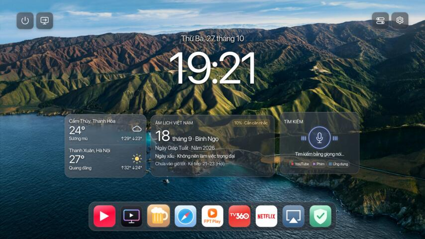

# macosLG · GathinTV

[Tiếng Việt](README.md) | **English**

A macOS-inspired home screen for compatible, rooted LG webOS TVs. A single Windows installer sets up the launcher and its supporting services. The complete launcher source is available in this repository.

**Tested reference TV:** LG 55SK8000PTA, firmware 05.50.70, webOS SDK 4.4.0, M16PP_DVB_EU, ARM32/Python 2. From **3.2.0**, **Restore** on already-rooted TVs detects available capabilities instead of requiring the reference model. Unsupported features are skipped and reported; reference-only tuning is not transplanted. Rooting an unrooted TV remains profile/firmware gated. A clean installation on a second TV has not yet been validated.

## Start here

| What you want | Where to go |
|---|---|
| Install it without learning programming | [Step-by-step installation guide](docs/INSTALL.en.md) |
| Download the Windows installer | [Latest release](https://github.com/twentykhz/macosLG/releases/latest) |
| Understand every feature | [Feature guide](docs/FEATURES.en.md) |
| Read or change the source | [Developer/source guide](docs/DEVELOPMENT.en.md) · [Launcher files](payload/app) |
| Find out what was checked | [Validation notes](docs/VALIDATION.md) |

**Regular users do not need to download this whole repository.** From the latest release, download `GathinTV-AutoSetup.ps1` and, for easier launching, `Start-Setup.cmd`. Put both in the same folder. You do not need the source ZIP, npm or a separately installed webOS CLI to run the installer.

Already rooted? Do not reinstall Developer Mode; follow the [already-rooted instructions](docs/INSTALL.en.md#already-rooted-tv). For an unrooted TV, the guide walks through the LG Developer account, installing Developer Mode, enabling Dev Mode Status, rebooting, and enabling Key Server.

## Before you begin

Write down **your TV's IP address** and **the six-character Developer Mode passphrase**. The passphrase is case-sensitive and is not your LG account password or the root SSH password. Never copy another TV's credentials or publish them in an issue. The installer asks for them when needed; you do not edit passwords into the script.

The TV and PC must be on the same home network. Rooting and HOME/voice integration change how the TV operates; compatibility checks remain enabled. You do not have to factory-reset a working rooted TV to update this launcher.

## What you get

| Feature | What it does |
|---|---|
| Glass-style home screen | Large clock/date, translucent neutral panels, readable text and focus highlights |
| Nine-icon dock | Compact when idle; names appear while navigating; slight zoom instead of an extra selection box |
| System controls | Inputs, Action Center, Settings and a small power/restart menu |
| Combined weather widget | Two locations together; click for hourly and roughly ten-day forecasts with two location tabs |
| Vietnamese lunar calendar | Lunar date, can chi, traditional day/hour indicators and family-specific suggestions in the detailed calendar |
| Voice widget | Opens the configured LG Voice Agent for supported device commands and YouTube AdFree searches |
| Wallpaper manager | Multiple original images, crop/display positioning, saved gallery and 5–60 second slideshow with fade |
| TV-hosted remote | Scan the Action Center QR from a phone/PC in the LAN; no PC server required while the TV is on |
| Screen viewing | On-demand JPEG frames at 360p, 480p, 720p or 1080p; not an audio/video stream at guaranteed FPS |
| Screenshot download | Original 1920×1080 PNG downloaded through your browser |
| Cleanup and loading policy | Temporary stream images removed, old browser frame URLs released, detailed forecasts loaded only when opened |

Starting with **3.1.1**, the launcher and AutoSetup use **SF Pro** as on the reference TV, with Inter retained as a fallback. SF Pro is an Apple third-party font and is not relicensed under this project's MIT license. App icons do not include paid subscriptions; install/sign in to FPT Play, TV360 or Netflix separately if desired.

Voice depends on LG services, language/consent/network availability and a compatible Magic Remote microphone. Pointer control works in the launcher and compatible web apps, not every native screen. Protected video may appear black. Lunar-calendar advice follows traditional conventions, not a guarantee of outcomes.

## Daily use

Open **Action Center → Remote Control & Settings** on the TV (the UI label is currently Vietnamese: **Điều khiển từ xa & Thiết lập**) and scan its QR. Remote navigation, screenshot download, wallpaper upload and weather location settings are available there. Each TV creates its own access key and QR; the default family members are editable examples, not the owner's family data.

When the TV is in standby its web page is offline. Another powered-on device in the home LAN must send Wake-on-LAN if you want to wake it. Access away from home additionally needs a configured VPN/subnet router or always-on relay; the installer does not publish the TV to the internet. [Details](docs/FEATURES.en.md#wake-on-lan-and-access-away-from-home).

## Repository versus release downloads

- **Repository:** readable source, configuration, build scripts, tests and documentation. Use `GathinTV-Source` when maintaining this repository.
- **GitHub Releases:** generated one-file installer and optional source ZIP/checksums. Use `GathinTV-Release` for release assets, not as a replacement for the repository source tree.

Do not upload `.local`, `node_modules`, SSH private keys, access keys, passphrases or personal backups. See [source/build instructions](docs/DEVELOPMENT.en.md).

## Getting help

[Open an issue](https://github.com/twentykhz/macosLG/issues/new/choose) with your TV model, firmware, SDK if known, Windows version, installation step and error text. Hide credentials, QR codes, account information and private keys. If the installer reports an unsupported profile, stop and include that message instead of rerunning the exploit repeatedly.

Project maintained by [twentykhz](https://github.com/twentykhz). See [LICENSE](LICENSE) and [third-party notices](THIRD-PARTY.md). This is an independent project, not an Apple or LG product.
