# MAC-WebOSTV by 20khzpc

**Bản mới 3.4.2:** thêm mục **Rollback — khôi phục trạng thái trước khi chạy tool** trong setup: chọn **4** trên Windows hoặc **8** trên Android, chọn backup của đúng TV rồi xác nhận `CO/YES`. Có thể khôi phục cả sau khi cài thành công. [Hướng dẫn tiếng Việt](docs/ROLLBACK.vi.md) | [English](docs/ROLLBACK.en.md).

Tài liệu 3.4.1 đã có bản tiếng Việt và tiếng Anh riêng: [Thay đổi VI](docs/CHANGELOG-v3.4.1.md) / [EN](docs/CHANGELOG-v3.4.1.en.md), [audit VI](docs/PYTHON-COMPATIBILITY.md) / [EN](docs/PYTHON-COMPATIBILITY.en.md), [kiểm chứng VI](docs/VALIDATION.md) / [EN](docs/VALIDATION.en.md). [Thay đổi 3.4.2](docs/CHANGELOG-v3.4.2.md).

**3.4.1 — Python không còn bắt buộc cho compatibility mode.** Backup, rollback, kiểm tra SHA-256, cập nhật launcher, Action Center Luna và theo dõi HDMI có đường chạy không Python. Windows và Android/Termux tiếp tục dùng chung Node core. [Phạm vi và audit](docs/PYTHON-COMPATIBILITY.md).

## Tương thích với TV LG đời mới đã root

TV mẫu đã kiểm chứng là **55SK8000PTA / M16PP_DVB_EU / 05.50.70**. TV đã root ngoài profile mẫu được cài thận trọng theo khả năng thực tế. Tính năng riêng của model không phù hợp sẽ được bỏ qua thay vì ép áp dụng.

Installer kiểm tra kiến trúc, root, Node, Python, SHA-256, tar và startup trước backup/cài đặt. TV không Python vẫn có thể cài launcher và dịch vụ Node nếu có đủ khả năng backup/rollback đã kiểm tra. Thiếu cả Node và Python thì vẫn có thể xuất backup bằng shell/tar, nhưng cài đặt có thay đổi sẽ bị chặn vì chưa có rollback an toàn. Không cài Python, tạo alias hay đưa binary ARM32 sang aarch64.

**OLED65C2PSA / O22_DVB_AJ / 33.31.68 / SDK 10.3.1:** đã thêm regression mô phỏng Setup, lỗi giữa chừng và rollback không Python. Chưa xác nhận cài bản 3.4.1 trên C2 thật, nên chưa xếp model này vào danh sách hardware-tested. Action Center phụ thuộc API Luna thực tế; HOME interception, Python2 voice router, QML/input patch và tuning TV mẫu được bỏ qua trên C2. Nút HOME/microphone gốc vẫn dùng theo firmware LG.

Chạy Doctor trước, thay `TV_IP` bằng IP TV cùng mạng LAN:

```bash
./GathinTV-AutoSetup.sh --mode Doctor --host TV_IP --trust-new-host
./GathinTV-AutoSetup.sh --mode Restore --host TV_IP --trust-new-host
```

Trên Windows dùng bản single-file **3.4.2** từ [Releases](https://github.com/twentykhz/macosLG/releases):

```powershell
.\MAC-WebOSTV-AutoSetup.ps1 -Mode Doctor -HostName TV_IP -TrustNewHost
.\MAC-WebOSTV-AutoSetup.ps1 -Mode Restore -HostName TV_IP -TrustNewHost
```

Chỉ chấp nhận host mới sau khi kiểm tra IP/fingerprint. Doctor không ghi file lên TV, không cài app, gửi input hoặc reboot. Khi Setup/Restore lỗi sau thay đổi, trả lời `CO`/`YES` để khôi phục snapshot đầu phiên của chính TV đó. [Thay đổi 3.4.1](docs/CHANGELOG-v3.4.1.md).

**Cài đặt và cứu hộ 3.4.0:** kiểm tra dịch vụ trước khi bật HOME; khi lỗi có lựa chọn `CO/YES` để khôi phục bằng backup đầu phiên. [Ảnh lỗi thực tế, chẩn đoán và phạm vi khôi phục](docs/diagnostics/RECOVERY.md).

**Bản 3.4.0:** Icon TV tự chọn cổng HDMI có tổng thời gian xem cao nhất; chưa có lịch sử sẽ mở bảng đầu vào. [Chi tiết](docs/CHANGELOG-v3.4.0.md).

**Bản 3.3.0:** dock tự co giãn, quản lý thành viên gia đình, cài LGWS và báo cáo chức năng. Tối ưu lại MAC-WebOSTV-AutoSetup.ps1 và Start-Setup.cmd. Mở CMD: chọn **1** nếu chưa root, **2** nếu đã root, **3** để xem báo cáo chức năng ngay trong setup. [Hướng dẫn đúng từng nhánh](docs/INSTALL.vi.md). [Thay đổi và các bước sau cài](docs/CHANGELOG-v3.3.0.md).

**Tiếng Việt** | [English](README.en.md)

Biến màn hình chính của TV LG webOS tương thích thành giao diện lấy cảm hứng từ macOS. Hỗ trợ cài và quản lý từ **Windows hoặc Android/Termux, Linux, macOS** qua cùng Node core. Windows giữ file AutoSetup PowerShell; điện thoại dùng shell và Node hệ thống, không cần máy tính Windows.

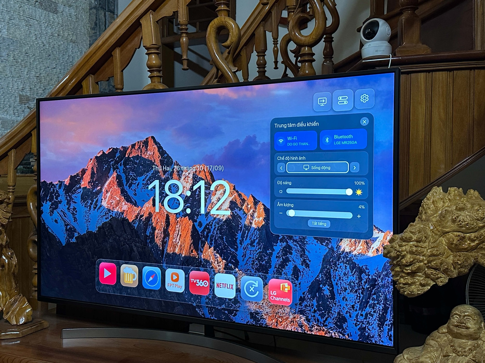

## Cài trên Windows

1. Tải 2 file từ [bản phát hành mới nhất](https://github.com/twentykhz/macosLG/releases/latest):
   - `MAC-WebOSTV-AutoSetup.ps1`
   - `Start-Setup.cmd`
2. Đặt **2 file cùng một thư mục**.
3. Bật TV và đảm bảo **TV + máy tính cùng Wi-Fi/LAN**.
4. Nhấp đúp `Start-Setup.cmd`.
5. Chọn:
   - `1` — TV chưa root
   - `2` — TV đã root
   - `3` — Kiểm tra TV
6. Nhập **IP của TV** và làm theo hướng dẫn trên màn hình.

> Không cần cài Node.js, npm hay webOS CLI.

📖 [Hướng dẫn Windows chi tiết](docs/INSTALL.vi.md)

---

## Cài trên Android

1. Cài **Termux**.
2. Bật TV và đảm bảo **điện thoại + TV cùng Wi-Fi/LAN**.
3. Mở Termux và chạy:

```bash
pkg update -y
pkg install nodejs git curl -y
curl -fsSL https://raw.githubusercontent.com/twentykhz/macosLG/main/install-android.sh | bash
```

4. Sau khi cài xong, mở menu:

```bash
cd "$HOME/.gathintv"
./GathinTV-AutoSetup.sh
```

5. Nhập **IP TV**, chọn TV **đã root / chưa root** rồi làm theo hướng dẫn.

📖 [Hướng dẫn Android / Termux chi tiết](docs/ANDROID.vi.md)

## Bạn muốn làm gì?

| Nhu cầu | Bấm vào đây |
|---|---|
| Cài launcher, chưa biết lập trình | [Hướng dẫn từng bước từ đầu](docs/INSTALL.vi.md) |
| Tải bộ cài Windows | [Bản phát hành mới nhất](https://github.com/twentykhz/macosLG/releases/latest) |
| Cài từ Android/Termux, Linux hoặc macOS | [Hướng dẫn shell, không cần Windows](docs/ANDROID.vi.md) |
| Xem từng tính năng và cách dùng | [Hướng dẫn tính năng](docs/FEATURES.vi.md) |
| Xem/chỉnh mã nguồn | [Hướng dẫn mã nguồn](docs/DEVELOPMENT.vi.md) · [Source launcher](payload/app) |
| Biết bản này đã kiểm tra đến đâu | [Ghi chú kiểm chứng](docs/VALIDATION.md) |

**Người chỉ muốn cài không cần tải cả repo.** Vào bản phát hành mới nhất, tải `MAC-WebOSTV-AutoSetup.ps1` và nên tải thêm `Start-Setup.cmd` để mở dễ hơn. Đặt hai file cùng một thư mục. Không cần tải source ZIP, tự cài npm hoặc webOS CLI để chạy AutoSetup.

**TV đã root:** không cài lại Developer Mode; làm theo [phần TV đã root](docs/INSTALL.vi.md#tv-đã-root). **TV chưa root:** hướng dẫn có đầy đủ bước tạo tài khoản LG Developer, cài Developer Mode, bật Dev Mode Status, reboot và bật Key Server.

## Hai thông tin phải ghi lại

Ghi **IP của chính TV cần cài** và **passphrase 6 ký tự trong Developer Mode**. Passphrase phân biệt chữ hoa/thường, khác mật khẩu tài khoản LG và mật khẩu SSH root. Không lấy thông tin của TV mẫu để điền vào TV khác. Không đăng chúng lên issue.

Bộ cài sẽ hỏi khi cần; không phải mở file script để sửa mật khẩu. TV và thiết bị chạy bộ cài (Windows/Android/Linux/macOS) cần chung mạng nhà. Root và việc đổi HOME/voice tác động tới hoạt động TV nên bộ cài vẫn giữ kiểm tra tương thích. TV đã root đang hoạt động không cần factory reset chỉ để cập nhật launcher.

**TV đã root:** ưu tiên khóa SSH đã lưu hoặc được chỉ định. Nếu không dùng khóa, bộ cài tự thử mật khẩu mặc định `alpine`; chỉ khi TV từ chối mới hỏi mật khẩu root riêng của bạn, nhập ẩn và không lưu mật khẩu.

**Ngôn ngữ setup:** chọn **1 — English** hoặc **2 — Tieng Viet khong dau**, sau đó chọn nhánh cài. Xác nhận kết nối chấp nhận `YES` hoặc `CO`, không phân biệt hoa/thường và bỏ khoảng trắng ở hai đầu.

**TV chưa root:** nhập model và firmware để nhận kết quả **có thể root / không có cách root phần mềm đã biết / chưa xác định**. Sau kết nối, setup đối chiếu lại thông tin thực tế. Ưu tiên faultmanager; khi thất bại, lỗi hiện ngay và được lưu trước khi chuyển sang cách còn phù hợp. Các cách cần USB/trình duyệt có hướng dẫn trong setup và phải xác minh UID 0 sau khi làm; NVM là thao tác phần cứng, không thể tự chạy từ PC. [Chi tiết kiểm tra và phương pháp dự phòng](docs/ROOTING-METHODS.md).

## Các tính năng hiện có

| Tính năng | Cách hoạt động |
|---|---|
| [Giao diện kính](#preview-home) | Đồng hồ/ngày lớn, nền trung tính trong suốt, chữ rõ khi nhìn xa, highlight khi chọn |
| [Dock tự co giãn](#preview-dock) | Thu gọn khi không dùng, hiện tên khi điều hướng, zoom nhẹ thay khung chọn thừa |
| [TV tự chọn HDMI](#preview-hdmi) | Icon TV và “mở ti-vi” dùng cổng có tổng thời gian xem cao nhất |
| [Điều khiển hệ thống](#preview-controls) | Nguồn vào, Action Center, Settings và menu tắt/khởi động lại TV gọn |
| [Thời tiết gộp](#preview-weather) | Hai địa điểm trên một widget; mở ra có hai tab, dự báo theo giờ và khoảng 10 ngày |
| [Âm lịch Việt Nam](#preview-calendar) | Ngày âm, can chi, đánh giá ngày/giờ dân gian; lịch chi tiết và gợi ý theo thành viên |
| [Widget giọng nói](#preview-voice) | Gọi Voice Agent đã cấu hình để điều khiển thiết bị và tìm qua YouTube AdFree |
| [Quản lý hình nền](#preview-wallpaper) | Nhiều ảnh gốc, crop/định vị, thư viện lưu lại, slideshow 5–60 giây có fade |
| [Remote chạy trên TV](#preview-remote) | Quét QR bằng điện thoại/PC cùng LAN; TV bật thì không cần PC làm máy chủ |
| [Xem màn hình TV](#preview-stream) | Chuỗi JPEG theo yêu cầu, chọn 360p/480p/720p/1080p; không bảo đảm FPS như video |
| [Lưu Screenshot](#preview-stream) | Tải PNG gốc 1920×1080 qua trình duyệt |
| [Đổi hai địa điểm thời tiết](#preview-weather-settings) | Tìm/chọn địa điểm từ điện thoại hoặc PC, áp dụng lên widget TV |
| [Quản lý thành viên](#preview-family-editor) | Thêm, sửa tên/ngày sinh và lưu trên TV để xem lịch theo từng người |
| Tải khi cần, dọn ảnh tạm | Dự báo chi tiết chỉ tải khi mở; ảnh stream tạm được xóa, khung hình cũ được giải phóng |

Từ bản **3.1.1**, launcher và AutoSetup dùng **SF Pro** như TV tham chiếu; Inter được giữ làm font dự phòng. SF Pro là font bên thứ ba của Apple, không được đổi giấy phép thành MIT của dự án. Icon FPT Play/TV360/Netflix không đồng nghĩa có sẵn thuê bao: người dùng tự cài và đăng nhập các app này nếu cần.

Voice phụ thuộc dịch vụ LG, Internet, ngôn ngữ/quyền voice và micro Magic Remote tương thích. Chuột trên ảnh hỗ trợ launcher/app web phù hợp, không thay thế mọi màn hình native. Video có bảo vệ có thể bị đen. Gợi ý lịch là quy ước dân gian để tham khảo.

## Ảnh preview từng tính năng

19 ảnh dưới đây được chụp trực tiếp từ giao diện source 3.4.0 chạy trong trình duyệt, với dữ liệu minh họa cho thời tiết, Wi-Fi/Bluetooth, HDMI và thành viên. QR dùng địa chỉ demo, không chứa khóa truy cập TV. Khung remote hiển thị ảnh launcher mẫu; đây là preview giao diện, không phải phép đo tốc độ stream hay xác nhận hoạt động trên mọi model. Bấm vào ảnh để xem bản lớn. [Thông tin bộ ảnh](docs/screenshots/README.md).

<a id="preview-home"></a>

### Màn hình chính và các widget

Đồng hồ lớn, ngày dương/âm, thời tiết hai khu vực và nút micro nằm cùng một màn hình. Nền ảnh có thể đổi từ trình quản lý hình nền.


<a id="preview-dock"></a>

### Dock thu gọn và hiện tên khi chọn

Dock thu gọn ở màn hình trên. Khi rê chuột hoặc điều hướng bằng remote, icon được chọn phóng nhẹ và hiện tên ứng dụng như ảnh dưới.


<a id="preview-hdmi"></a>

### Icon TV tự chọn cổng HDMI

Ảnh minh họa shortcut đang dùng **HDMI 2**. Sau Setup/Restore, bộ theo dõi chọn cổng có tổng thời gian xem cao nhất khi TV bật; chưa có lịch sử thì mở bảng đầu vào để chọn. Lệnh “mở ti-vi” dùng cùng lựa chọn. [Chi tiết cơ chế và giới hạn](docs/CHANGELOG-v3.4.0.md).

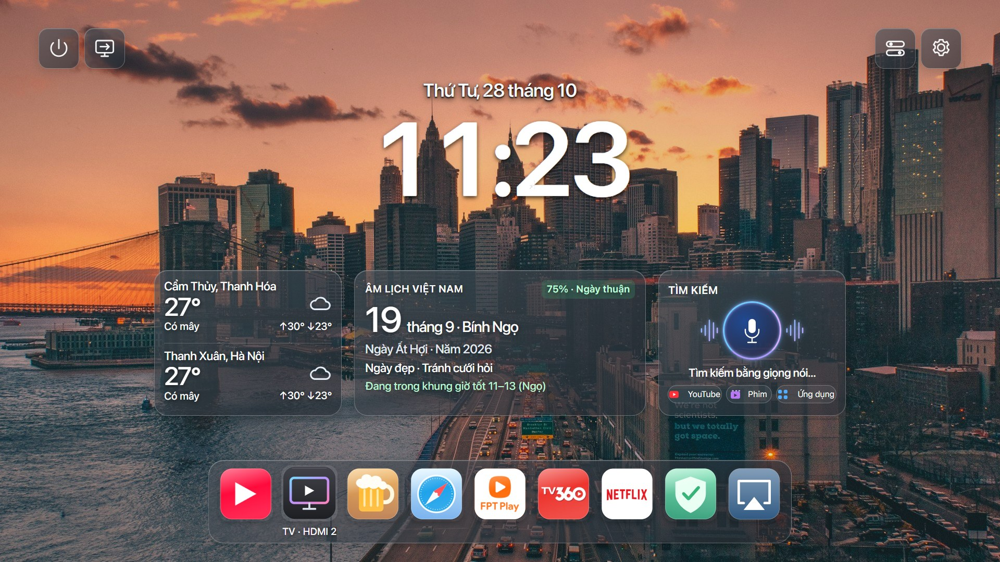

<a id="preview-controls"></a>

### Action Center và menu nguồn

Mở nút hai thanh gạt phía trên bên phải để chỉnh Wi-Fi, Bluetooth, chế độ hình ảnh, độ sáng, âm lượng và tắt tiếng. Nút cuối mở QR cho trang điều khiển/thiết lập.

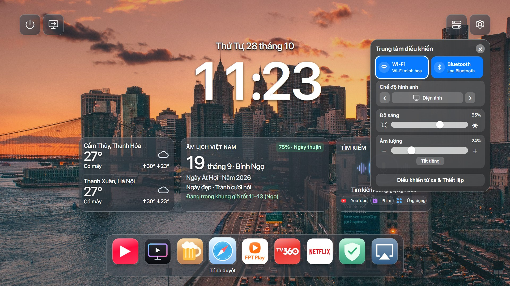

Nút nguồn phía trên bên trái mở menu gọn gồm **Tắt TV**, **Khởi động lại TV** và **Đóng**.

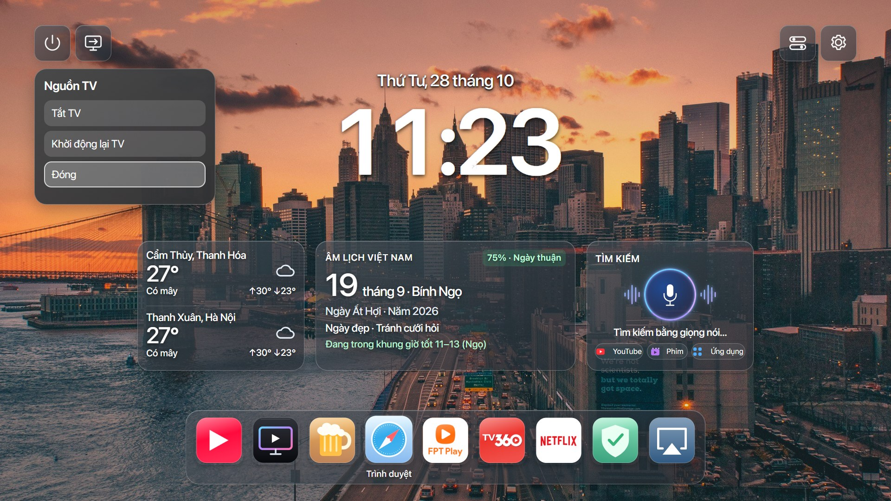

<a id="preview-weather"></a>

### Thời tiết hai địa điểm, dự báo giờ và 10 ngày

Chọn widget thời tiết để mở chi tiết: nhiệt độ, độ ẩm, gió, 12 giờ tiếp theo và dự báo 10 ngày. Hai tab phía trên đổi khu vực; số liệu trong ảnh là dữ liệu mẫu.

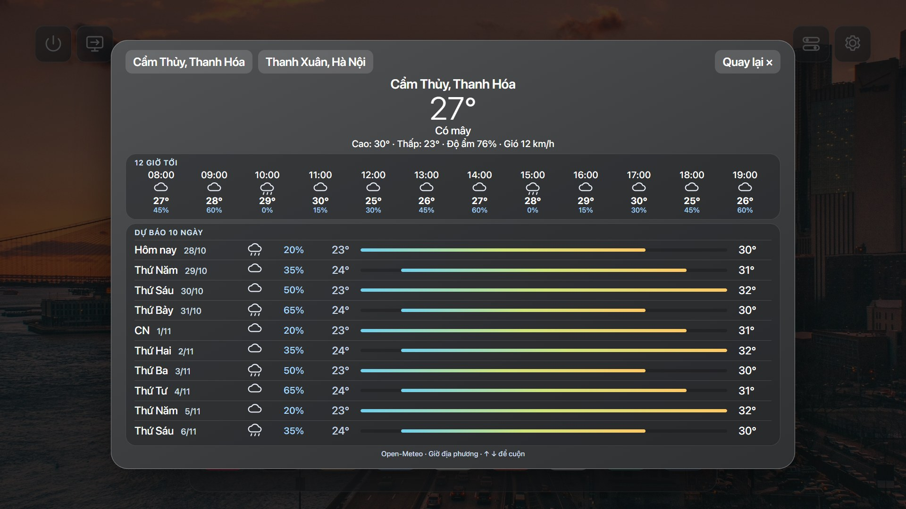

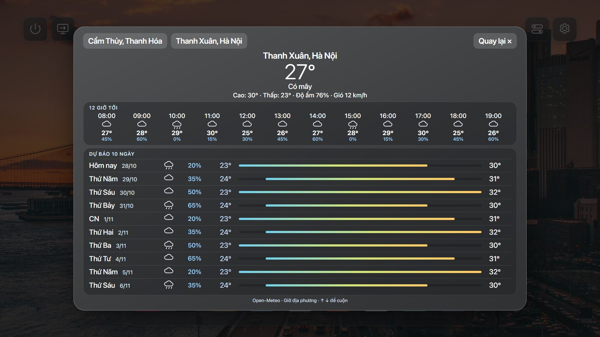

<a id="preview-calendar"></a>

### Âm lịch, giờ tốt và gợi ý theo thành viên

Mở widget âm lịch để xem lịch tháng, ngày dương/âm, can chi, giờ tốt và hai cột **Nên làm / Không nên làm**. Bốn hướng chọn ngày; **Về hôm nay** quay lại ngày hiện tại.

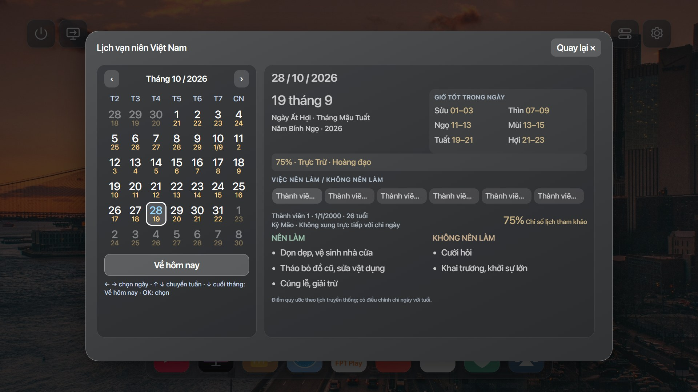

Chọn thành viên để xem phần gợi ý tương ứng. Bộ ảnh dùng tên và ngày sinh mẫu; thông tin lịch theo quy ước dân gian, không phải dự đoán bảo đảm.

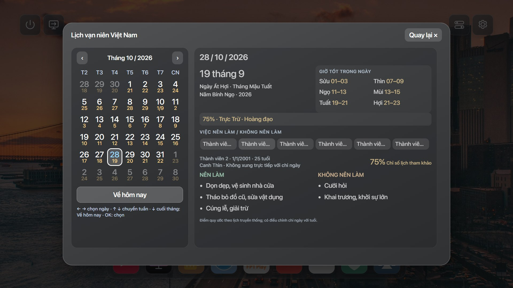

<a id="preview-voice"></a>

### Widget tìm kiếm và điều khiển bằng giọng nói

Widget micro là điểm mở LG Voice Agent. Có thể nói lệnh được hỗ trợ để điều khiển TV/app, hoặc tìm nội dung qua YouTube AdFree. Ảnh thể hiện widget trên launcher; việc nhận giọng nói cần dịch vụ LG và micro remote tương thích.

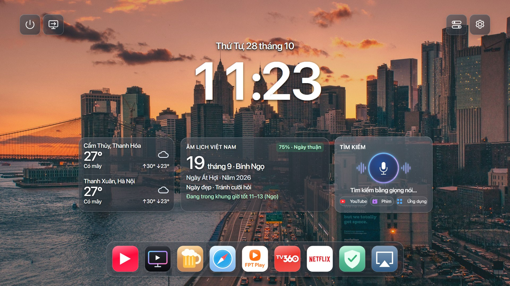

<a id="preview-remote"></a>

### Quét QR để mở remote và thiết lập

Trong Action Center chọn **Điều khiển từ xa & Thiết lập**, dùng điện thoại cùng LAN quét QR. QR trong ảnh là demo; khi dùng thật, TV tự tạo liên kết và khóa riêng.

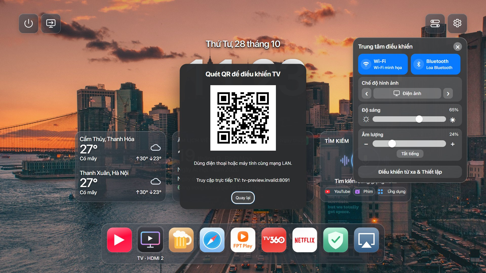

<a id="preview-stream"></a>

### Remote trên PC: xem màn hình, điều khiển và lưu screenshot

Cột phải có nguồn/restart, chất lượng **360p–1080p**, **Lưu Screenshot**, điều khiển chuột, bốn hướng/OK, Home/Back và âm lượng. **Lưu Screenshot** tải PNG gốc 1920×1080. Khung trái dưới đây đang hiển thị ảnh launcher mẫu; stream thực tế là chuỗi JPEG, không có âm thanh.

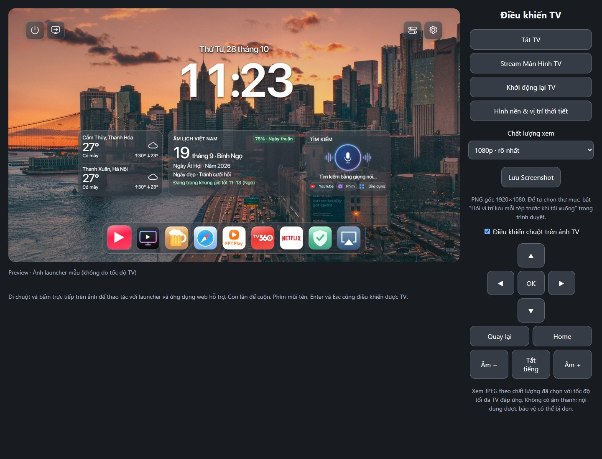

### Remote trên điện thoại

Giao diện tự xếp lại theo chiều dọc: khung xem và lựa chọn chất lượng ở phía trên, các phím điều khiển ở phía dưới. Hai ảnh chụp thể hiện hai phần của cùng trang trên màn hình hẹp.

<p>
  <a href="docs/screenshots/13-remote-mobile.jpg">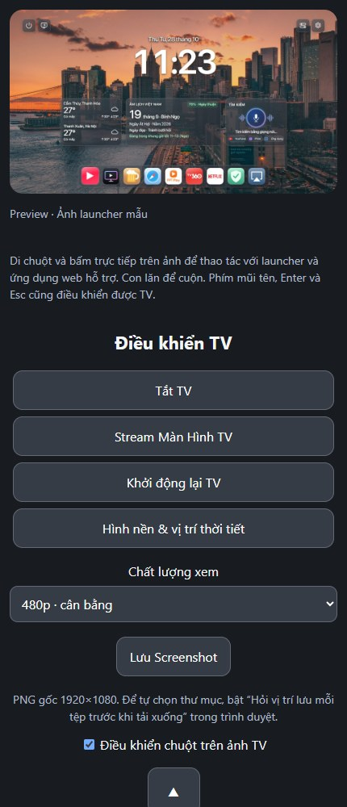</a>
  <a href="docs/screenshots/19-remote-mobile-controls.jpg">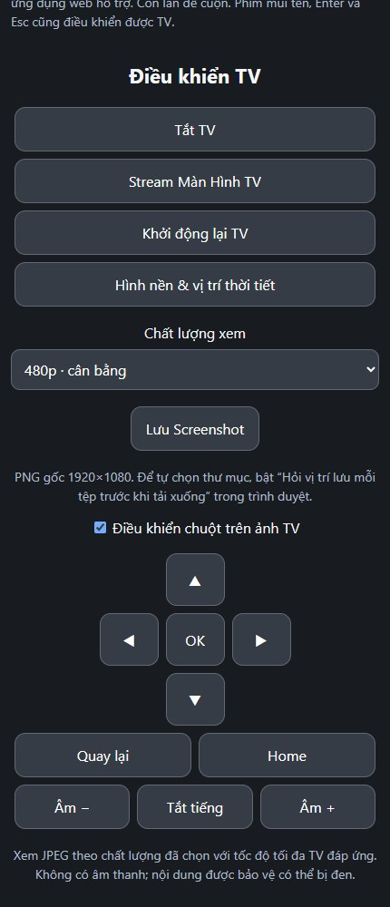</a>
</p>

<a id="preview-wallpaper"></a>

### Thư viện hình nền và slideshow

Từ remote chọn **Hình nền & vị trí thời tiết**. Đánh dấu nhiều ảnh trong thư viện, bật **Chạy slideshow**, đặt khoảng **5–60 giây** rồi bấm **Áp dụng lên TV**. Ảnh minh họa đang chọn ba hình và khoảng chuyển 15 giây.

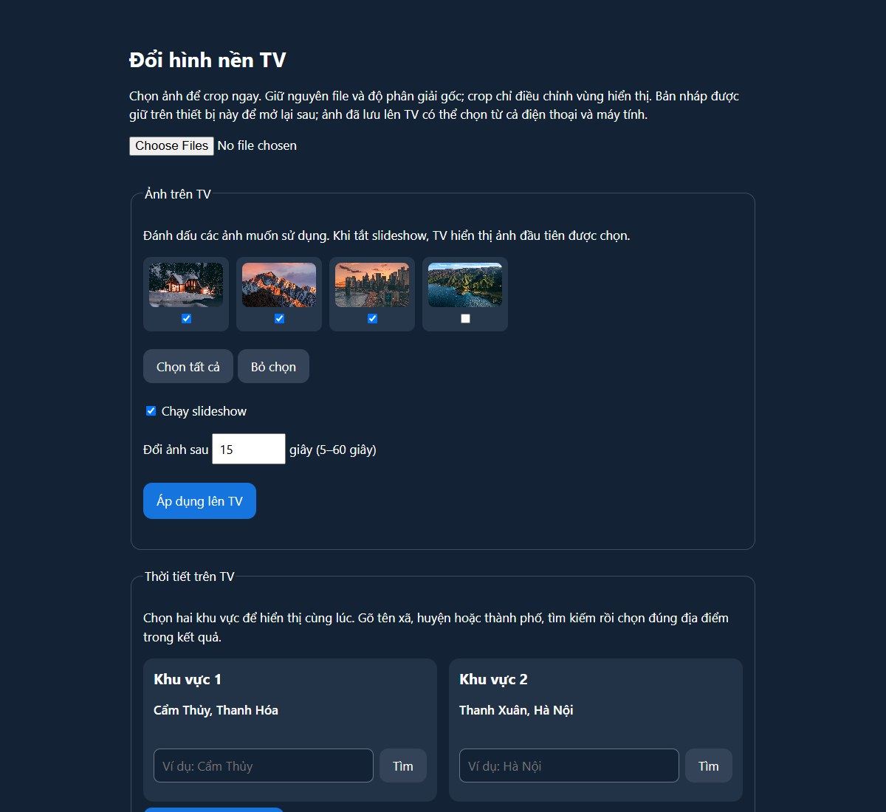

### Crop, zoom và lưu bản nháp ảnh

Chọn ảnh từ điện thoại/PC để mở bản nháp. Kéo ảnh và chỉnh thanh **Phóng to** trước khi lưu một ảnh hoặc cả nhóm vào thư viện TV; ảnh gốc được giữ lại.

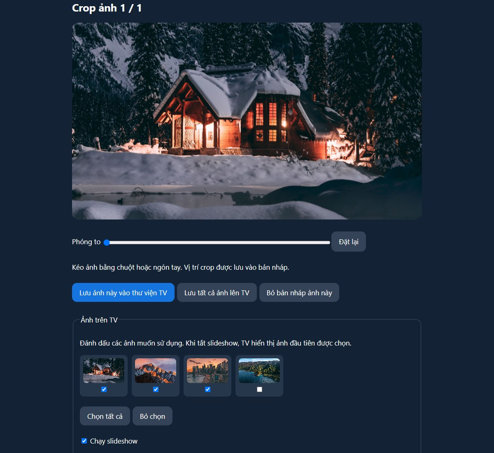

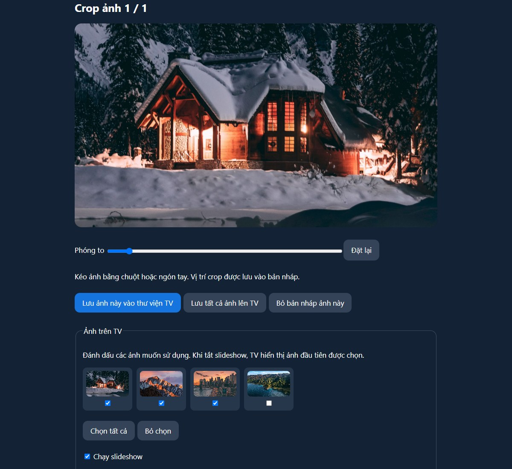

<a id="preview-weather-settings"></a>

### Đổi hai khu vực thời tiết từ trình duyệt

Tìm và chọn địa điểm cho từng khu vực, sau đó bấm **Áp dụng hai khu vực**. Widget và hai tab chi tiết trên TV dùng các vị trí đã lưu.

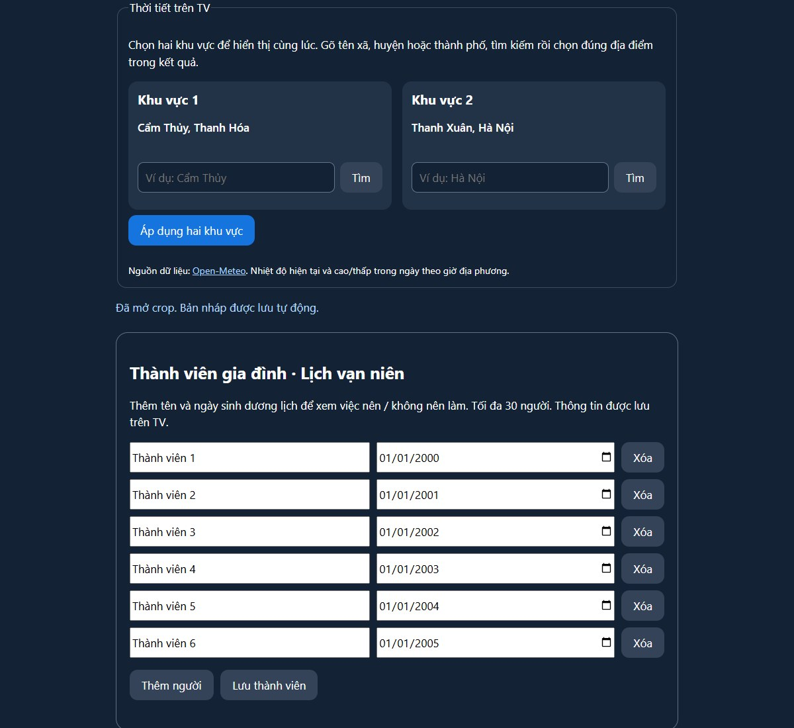

<a id="preview-family-editor"></a>

### Thêm, sửa và xóa thành viên gia đình

Trong cùng trang thiết lập, phần **Thành viên gia đình · Lịch vạn niên** cho sửa tên/ngày sinh, thêm hoặc xóa người, rồi **Lưu thành viên**. Đóng và mở lại lịch trên TV để cập nhật; ảnh dùng sáu thành viên mẫu.

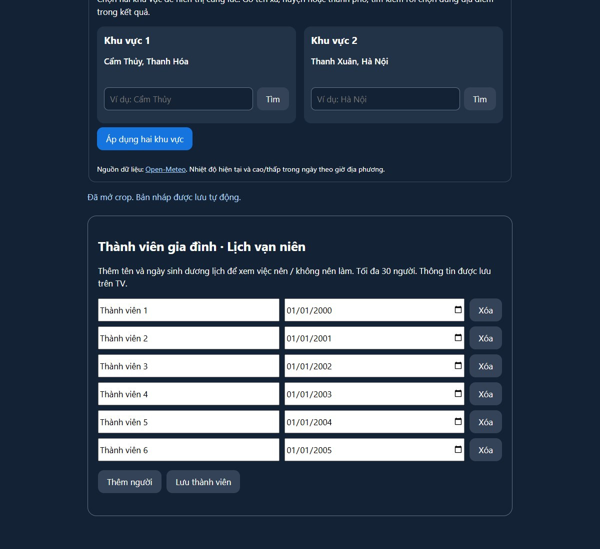

Dự báo chi tiết chỉ tải khi mở; stream tạm được dọn sau khi gửi và trình duyệt giải phóng ảnh cũ. Đây là cơ chế chạy nền, không có bảng đo RAM riêng trong bộ ảnh. [Chi tiết dữ liệu tạm và dịch vụ](docs/FEATURES.vi.md#dữ-liệu-tạm-và-dịch-vụ).

## Dùng hằng ngày ở đâu?

Trên TV mở **Action Center → Điều khiển từ xa & Thiết lập**, quét QR. Từ đây dùng remote, tải screenshot, đổi hình nền và hai địa điểm thời tiết. Mỗi TV tự tạo khóa/QR riêng; thông tin thành viên đi kèm là dữ liệu mẫu có thể sửa.

Khi TV tắt/chờ, trang web trên TV cũng dừng. Muốn đánh thức cần thiết bị khác còn bật trong LAN gửi Wake-on-LAN. Muốn dùng ngoài nhà cần VPN/subnet router hoặc thiết bị trung gian đã cấu hình; bộ cài không tự mở TV ra Internet. [Xem cách hoạt động](docs/FEATURES.vi.md#wake-on-lan-và-truy-cập-ngoài-nhà).

## Khi cần hỗ trợ

[Tạo issue](https://github.com/twentykhz/macosLG/issues/new/choose), ghi model TV, firmware, SDK nếu biết, Windows đang dùng, bước đang làm và nguyên văn lỗi. Che QR, mật khẩu, passphrase, tài khoản và khóa riêng. Nếu báo không tương thích, dừng và gửi thông tin thay vì chạy exploit lặp lại.

Duy trì bởi [twentykhz](https://github.com/twentykhz). Xem [LICENSE](LICENSE), [thành phần bên thứ ba](THIRD-PARTY.md). Đây là dự án độc lập, không phải sản phẩm của Apple hay LG.
