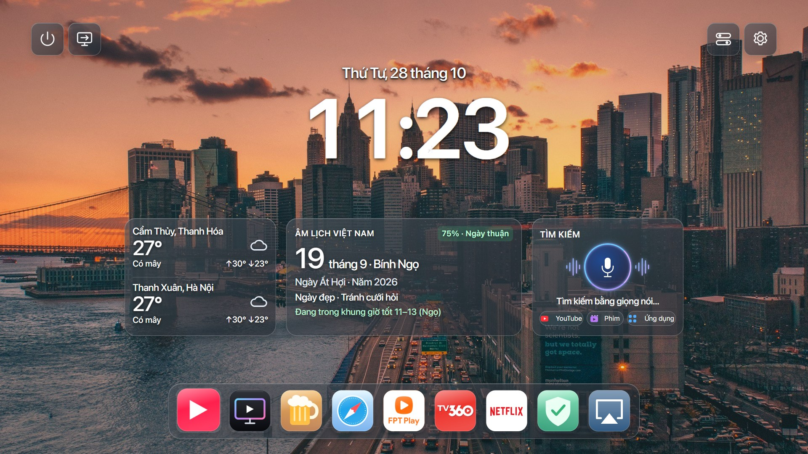

# MAC-WebOSTV

Giao diện lấy cảm hứng từ macOS cho TV LG webOS tương thích. **Chọn thiết bị bạn dùng để cài bên dưới.** TV và thiết bị cài cần cùng Wi-Fi/LAN.

**Tiếng Việt** | [English](README.en.md) · Phiên bản **3.5.0**

| Bạn đang dùng | Bắt đầu tại đây | Cần tải gì? |
|---|---|---|
| **Máy tính Windows** | **[Cài trên Windows →](windows/README.md)** | Một file ZIP, giải nén rồi mở `Start-Setup.cmd` |
| **Điện thoại Android** | **[Cài trên Android / Termux →](android/README.md)** | Chạy lệnh trong Termux; không tải file Windows |
| Linux / macOS | [Hướng dẫn shell](android/README.en.md) | Bash và Node.js 20+ |

**Chỉ muốn cài? Không cần bấm Code → Download ZIP hay mở các thư mục mã nguồn.** Dùng đúng hướng dẫn theo thiết bị ở bảng trên.

[Xem thay đổi 3.5.0: boot, HOME, voice, debloat và privacy](docs/CHANGELOG-v3.5.0.md).

## Trước khi cài

- **TV đã root:** chọn nhánh đã root trong setup; không cần cài lại Developer Mode hay factory reset.
- **TV chưa root:** bật **Dev Mode Status**, cho reboot rồi bật **Key Server**. Setup kiểm tra trạng thái, tự đọc model/firmware sau xác thực và báo khả năng root; không phải mọi TV LG đều hỗ trợ.
- Phần cứng đã kiểm chứng: **55SK8000PTA / firmware 05.50.70**. Mọi model dùng chung luồng boot/HOME/voice/debloat/privacy, kiểm tra phần cứng và API trước khi kích hoạt. UM7400/C2 chưa được kiểm chứng vật lý trong bản này.

## Tài liệu cần dùng

| Nội dung | Liên kết |
|---|---|
| Tính năng, giao diện và ảnh | [Xem trước](docs/OVERVIEW.vi.md) · [Cách sử dụng](docs/FEATURES.vi.md) |
| Backup / khôi phục | [Hướng dẫn Rollback](docs/ROLLBACK.vi.md) |
| Thay đổi 3.5.0 | [Rollback và bản sửa YouTube AdFree](docs/CHANGELOG-v3.5.0.md) |
| Khắc phục lỗi, tương thích | [Mục lục tài liệu](docs/README.md) |
| Sửa mã nguồn / tự build | [Hướng dẫn phát triển](docs/DEVELOPMENT.vi.md) |

## Mã nguồn nằm ở đâu?

`windows/` và `android/` là hai lối cài đặt. `payload/` chứa launcher/dịch vụ TV; `lib/`, `scripts/`, `config/`, `packages/`, `upstream/` là thành phần dùng chung để build và chạy bộ cài; `test/` là kiểm thử. File bộ cài đóng gói nằm trong [Releases](https://github.com/twentykhz/macosLG/releases/latest).

Tên chính thức / Official name: **MAC-WebOSTV**. Download the current installer again when updating older saved launch commands. Existing private backup/key state is discovered automatically.
