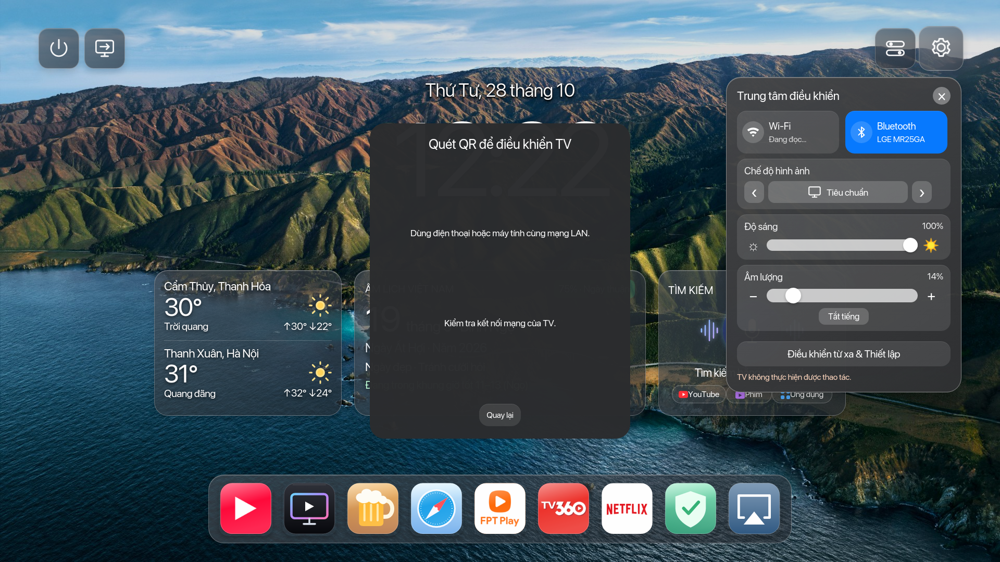

# Cài đặt lỗi và khôi phục / Installation failure and recovery



Ảnh trên là tình trạng lỗi, không phải ảnh chứng minh tính năng đã hoạt động. Log và backup riêng của TV được dùng để chẩn đoán; chúng không được đưa lên GitHub.

## Kết quả đối chiếu

Log ghi nhận `Unable to exec` sau khi đã có backup và thay launcher, trước khi hoàn tất dịch vụ. Thông báo cũ “stopped before changing HOME hooks” không có nghĩa toàn bộ TV chưa bị thay đổi: gói launcher đã được cài.

Trong snapshot lỗi, `remote-access.js` chứa URL trống. Dịch vụ cũ chỉ xuất URL khi khởi động nên không sửa lại file sau khi IPK ghi đè. Token giao diện và bridge trong snapshot này **khớp nhau**; không có bằng chứng token sai là nguyên nhân của lần lỗi này.

Mã hiển thị hình nền trước đây loại `wallpaper.jpg` khỏi danh sách hợp lệ dù đó là ảnh mặc định của gói. Việc xóa nền body làm trường hợp cài mới dễ hiển thị nền trống. Đây là lỗi xác định được trong mã; snapshot lỗi vẫn có danh sách ảnh riêng hợp lệ.

Action Center trước đây gọi một số API đặc quyền trực tiếp từ ứng dụng. Việc cài lại IPK có thể thay đổi quyền ứng dụng, còn bước cấp quyền chưa chạy nếu setup dừng sớm. Kiểm tra **chỉ đọc** trên TV tham chiếu xác nhận Wi-Fi, Bluetooth, âm lượng, độ sáng và chế độ hình ảnh trả dữ liệu khi gọi qua root. Điều này xác nhận đường gọi thay thế trên TV đó, không chứng minh mọi model hỗ trợ cùng API.

## Cách setup xử lý

1. Sau khi có root được xác minh, lưu snapshot riêng trên PC **trước khi cài ứng dụng hoặc thay giao diện**. Snapshot gồm launcher, ảnh và cấu hình riêng, token và trạng thái các dịch vụ dự án, boot hooks, quyền ứng dụng và danh sách tiến trình đang chạy. Snapshot đầu phiên không bị ghi đè bởi backup tạo sau đó.
2. Dừng dịch vụ dự án và nhả HOME trước khi thay file. Khi launcher đã đăng ký cùng phiên bản, nâng cấp thư mục qua staging và đổi tên, giữ cấu hình riêng; không cài lại IPK để cập nhật cùng phiên bản. Khi cần cài IPK do thay phiên bản, giữ lại và kiểm tra hash của ảnh/cấu hình riêng qua bước cài.
3. Bridge thực hiện các API điều khiển bằng root, với token riêng của TV. Tính năng không có API được báo không hỗ trợ; Wi-Fi không chờ “Đang đọc” vô hạn. Có đường mở Cài đặt gốc.
4. Dịch vụ xuất lại cấu hình QR/hình nền định kỳ. Hộp QR đọc lại cấu hình khi mở. Hình nền mặc định vẫn hợp lệ và làm nền dự phòng.
5. Kiểm tra token khớp, phản hồi có xác thực, phiên bản giao thức bridge, URL QR và ảnh đã chọn trước khi kích hoạt HOME. Cổng HTTP mở hoặc phản hồi 403 không được tính là cài thành công.
6. Chỉ thử lại lệnh SSH khi server từ chối mở kênh với đúng lỗi `Unable to exec`, bằng kết nối mới đã kiểm tra host key. Lệnh đã chạy nhưng mất trạng thái kết thúc không bị tự phát lại.

## Khi setup báo lỗi

AutoSetup hiển thị vị trí backup, TV và thời điểm, rồi hỏi:

```text
Ban co muon quay ve trang thai ban dau cua TV theo backup dau phien nay khong? (CO/YES)
```

Nhập `co`, `CO`, `yes` hoặc `YES` đều được. Tiếng Anh có lựa chọn tương đương. Setup tự kết nối lại, kiểm tra đúng TV và SHA-256, chuẩn bị/kiểm tra file trước khi thay, khôi phục snapshot và chạy lại đúng các dịch vụ đã hoạt động trước đó. File phát sinh trong phạm vi dự án được chuyển sang nơi giữ chẩn đoán, không trộn vào backup. Ứng dụng dự án vừa thêm trong phiên được gỡ nếu trước đó chưa có; ứng dụng có sẵn được giữ. Nếu chưa có snapshot hợp lệ hoặc chưa thay đổi gì, không đề nghị dùng nhầm backup phiên khác.

Nếu kết nối hoặc khôi phục không hoàn tất, setup báo lỗi khôi phục riêng và giữ backup để thử lại. Không báo thành công chỉ vì đã gửi lệnh. Giữ PC và TV cùng mạng, không tắt TV trong khi khôi phục.

Đây là khôi phục **phạm vi launcher và dịch vụ đã lưu trong backup**, không phải ảnh toàn bộ ổ đĩa hay factory reset. Root/Homebrew và khóa SSH phục vụ cứu hộ được giữ; không hoàn tác firmware, rooting, tài khoản LG hoặc dữ liệu ứng dụng bên ngoài snapshot. Xóa ứng dụng không liên quan bằng `-RemoveExtraApps` bị chặn trong setup có bảo vệ snapshot vì dữ liệu đó không nằm trong backup. Tùy chỉnh privacy có hiệu lực ngoài file cấu hình cần kiểm tra lại trong LGWS sau khôi phục.

Backup, token và log nằm trên PC trong thư mục state đang được setup hiển thị. Không chia sẻ nguyên thư mục này công khai. Ảnh trên được người dùng yêu cầu đính kèm; không kèm archive, khóa hoặc log riêng.

## Validation and limits

Automated checks cover first-snapshot reuse, wrong TV/checksum/path rejection, recovery failure reporting, real-file rollback in an isolated filesystem, authenticated readiness, default wallpaper fallback, late QR publication, and real loopback HTTP services repairing overwritten configuration. Python recovery scripts and the ES5 readiness probe were syntax-checked using the reference TV's actual Python 2 and Node runtimes. A full new snapshot was read and validated without changing the restored TV's launcher or services.

The updated installer has not been deployed to a second physical TV or used for an end-to-end failure rollback on that TV. Unsupported hardware capabilities remain model-dependent. Physical HOME/Back, rendered QR scanning, image decoding, privacy effects and power behavior still require checks on the destination TV.

In English: when an installation fails after mutations, answer `YES` or `CO` to restore the **first snapshot from that run**. Matching is case-insensitive. Recovery validates the bound TV and archive, restores project files/private state, removes added project files/apps and restarts the previously active project services. It does not undo rooting, firmware or unrelated application/account data. A failed recovery is reported separately and leaves the backup available.
